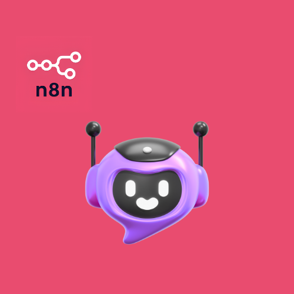
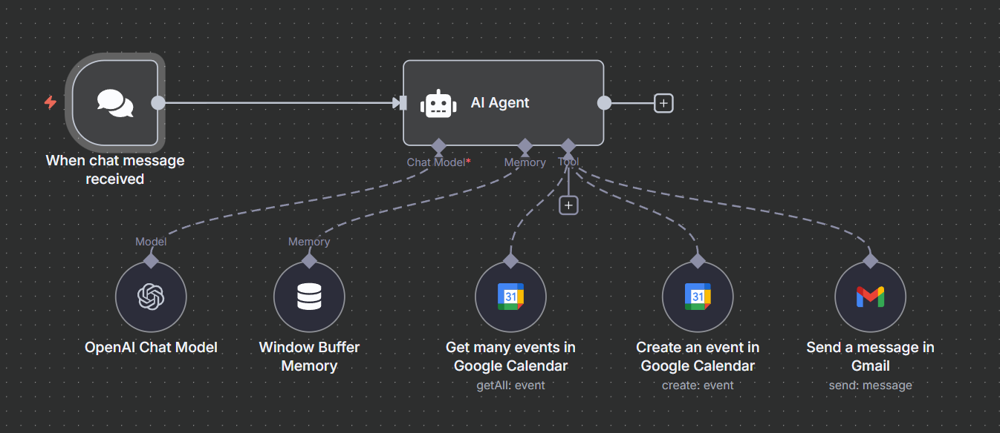

# Website Chatbot with Meeting Scheduler and Gmail Integration

An n8n workflow that runs an AI chatbot on a website. The chatbot answers questions about an agency's services and books consultation meetings in Google Calendar, with Gmail available for email.

## Overview

Website visitors send messages through an n8n chat interface. An AI agent replies in short, casual messages and keeps the last 30 messages as conversation memory. The agent describes the agency's services: Flutter mobile app development, n8n workflow automation, and AI agent development.

When a visitor wants a consultation, the agent collects the booking details, checks the calendar for conflicts, and creates a Google Calendar event with a Google Meet link. The system consists of one workflow.

## Workflows

| Workflow | Trigger | Purpose |
| --- | --- | --- |
| Website Chatbot with Meeting Scheduler & Gmail Integration | Chat message received through a public webhook | Answers visitor questions and books meetings using Google Calendar and Gmail |

## Workflow Details

### Website Chatbot with Meeting Scheduler & Gmail Integration

This workflow turns each incoming chat message into an AI agent response, with calendar and email actions available as tools.

**Trigger:** The **Chat Trigger** node, named "When chat message received", starts the workflow when a visitor sends a message. It runs in public webhook mode and retries on failure after a 3 second wait.

Execution steps:

1. The Chat Trigger node passes the visitor's message to the AI Agent node.
2. The AI Agent loads the recent conversation from the Window Buffer Memory node, which holds the last 30 messages.
3. The Google Gemini Chat Model node, set to a temperature of 0.7, generates the agent's reasoning and replies.
4. The agent first retrieves the existing meetings with the Google Calendar read tool, without mentioning this to the visitor.
5. The agent answers questions about the agency's services.
6. When the visitor asks for a meeting, the agent asks for a first name, an email address for the Google Meet link, and a preferred date and time.
7. The agent confirms all details with the visitor before booking.
8. The agent creates the event with the Google Calendar create tool and can send an email with the Gmail tool.
9. The agent returns its reply to the chat.

Branching logic, which the agent applies through its system prompt:

- A requested slot that is free leads to confirmation and booking.
- A requested slot that is already booked leads to 2 or 3 alternative slots, with priority for the next two days.
- A date more than 7 days ahead, or a Sunday, is declined.
- A message unrelated to the agency or to booking is redirected to those topics.

The workflow contains no loops and no sub-workflow calls. An error workflow is configured in the workflow settings.

Agent behavior defined in the system prompt:

- The agent uses a witty, casual tone with short, SMS-style messages.
- The agent works in the Asia/Karachi timezone and restates it when discussing times.
- The agent checks availability with the calendar tool before every booking.

Tools available to the agent:

- **Get info from Google Calendar** reads up to 10 events in a time range chosen by the agent, in the Asia/Karachi timezone.
- **Create meeting schedule in Google Calendar** creates an event with a start time, end time, summary, and description supplied by the agent.
- The created event adds the visitor's email as an attendee, adds one fixed attendee configured in the node, and attaches a Google Meet link.
- The created event is marked as busy.
- **Send message in Gmail** sends a plain text email whose recipient, subject, and body come from the agent, with the n8n attribution line turned off.

Integrations used: Google Gemini, Google Calendar, Google Meet, Gmail.

## Integrations

- Google Gemini
- Google Calendar
- Google Meet
- Gmail

## Prerequisites

- An n8n instance that includes the AI nodes (Chat Trigger, AI Agent, Window Buffer Memory, Google Gemini Chat Model).
- A Google Gemini (PaLM) API credential.
- A Google Calendar OAuth2 credential for an account that can read and create events on the target calendar.
- A Gmail OAuth2 credential for the sending account.
- A Google account that supports Google Meet links on calendar events.

## Setup

1. Import the JSON file from the `workflows` directory into n8n.
2. Create the Google Gemini (PaLM) API, Google Calendar OAuth2, and Gmail OAuth2 credentials in n8n.
3. Assign each credential to its node: the Google Gemini Chat Model node, both Google Calendar tool nodes, and the Gmail tool node.
4. Select your own calendar in both Google Calendar tool nodes.
5. Review the fixed attendee in the Google Calendar create tool and replace it with your own.
6. Review the system prompt in the AI Agent node, including the business description, timezone, and booking rules.
7. Select an error workflow in the workflow settings, or remove the existing reference if it does not exist in your instance.
8. Activate the workflow and connect the chat interface to your website.
